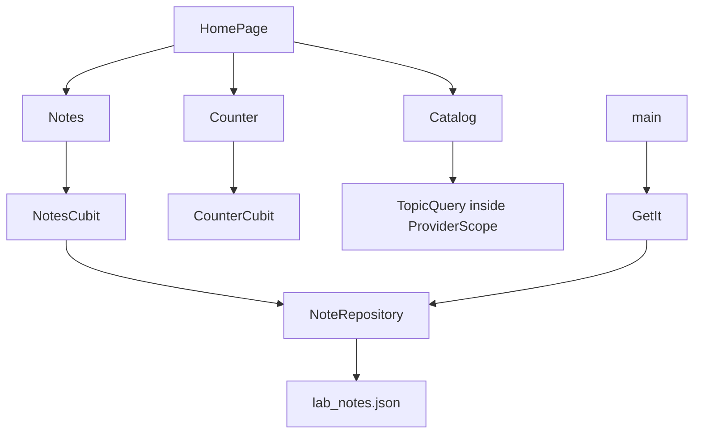

# Architecture Lab

Architecture Lab is a small sample app that keeps three styles of state in separate routes:

- Notes use a cubit, a repository, and a `Result` type.
- The counter is a second cubit that is created only for its route.
- The catalog filter uses Riverpod, and only inside that route's `ProviderScope`.

The home screen also reads a platform channel. Android returns `Android <release>`. iOS returns `iOS <version>`. If the channel is missing, the label falls back to `defaultTargetPlatform.name`.

Notes in the real app are stored in `lab_notes.json` on the device. The app is not deployed.

## Problem

Mixing Cubit and Riverpod in one feature makes an interview explanation muddy. This lab keeps each tool in the place it is actually used.

## Features

- Home with a device label and three routes
- Notes: create, list, confirmed delete, validation, load and save errors
- Counter: plus and minus, disposed with the route
- Catalog: filter a fixed list of four topics
- Shared buttons, fields, cards, and a status view
- Light and dark themes
- GetIt only in `main`, for the file repository

## Screenshots

Screenshots have not been captured. Widget tests cover the three routes on a 390×900 surface.

## Architecture



`Result` is a sealed type: `Success` or `Failure`. The notes repository returns it. The cubit does not parse exceptions from the file.

## Why each tool is where it is

Notes load and save asynchronously and need a failure message that is not an exception string. A cubit method reads clearly for that.

The counter has no I/O. A one-integer cubit is enough, and it is not registered in GetIt.

The catalog is a constant list plus a query string. A Riverpod `Notifier` and a derived `Provider` stay on that route. The notes cubit does not watch them.

## Folder structure

```text
lib/
  main.dart
  injection.dart
  app.dart
  core/result.dart
  core/device_label.dart
  design/components.dart
  features/notes/
  features/counter/
  features/catalog/
  presentation/home_page.dart
test/
integration_test/app_test.dart
```

Navigation is `Navigator.push` and `MaterialPageRoute`. There is no router package.

## Platform channel

Channel name: `com.shubhamtomar.architecture_lab/device`

Method: `label`

- Android: `MainActivity.configureFlutterEngine`
- iOS: `AppDelegate.didInitializeImplicitFlutterEngine`

Widget tests mock the channel with `TestDefaultBinaryMessenger`. The iOS and Android handlers were not executed on a device in this snapshot.

## Setup

Flutter 3.44.9 and Dart 3.12.2.

```bash
flutter pub get
flutter run
```

No API keys. The note file is created on first save under the app documents directory.

## Testing

Verified locally on 12 October 2026 with Flutter 3.44.9:

- `flutter analyze` — no issues
- `flutter test` — 6 tests passed

`integration_test/app_test.dart` is in the repo. It was not executed here. Starting it launched an Xcode build, which was stopped. `flutter test` does not run that folder. CI matches `flutter test`.

Coverage was not measured.

```bash
dart format --output=none --set-exit-if-changed .
flutter analyze
flutter test
```

## Known limitations

- The catalog list is constant. It is not loaded from the note file.
- GetIt is not used by the counter or the catalog.
- The platform label was verified with a mock channel, not on a phone.
- The integration test file has not been run to completion.
- Screenshots have not been captured.

## Future improvements

- Run `integration_test/app_test.dart` on a simulator and record the result
- Capture screenshots, including the Android or iOS device label
- Add a second note-file migration test

## Interview notes

See [INTERVIEW_GUIDE.md](INTERVIEW_GUIDE.md).

## License

[MIT](LICENSE) © 2026 Shubham Tomar

## Links

- Author: Shubham Tomar — shubhamtomarr68@gmail.com
- GitHub: https://github.com/shubhamtomarr68-hub/flutter-architecture-lab
